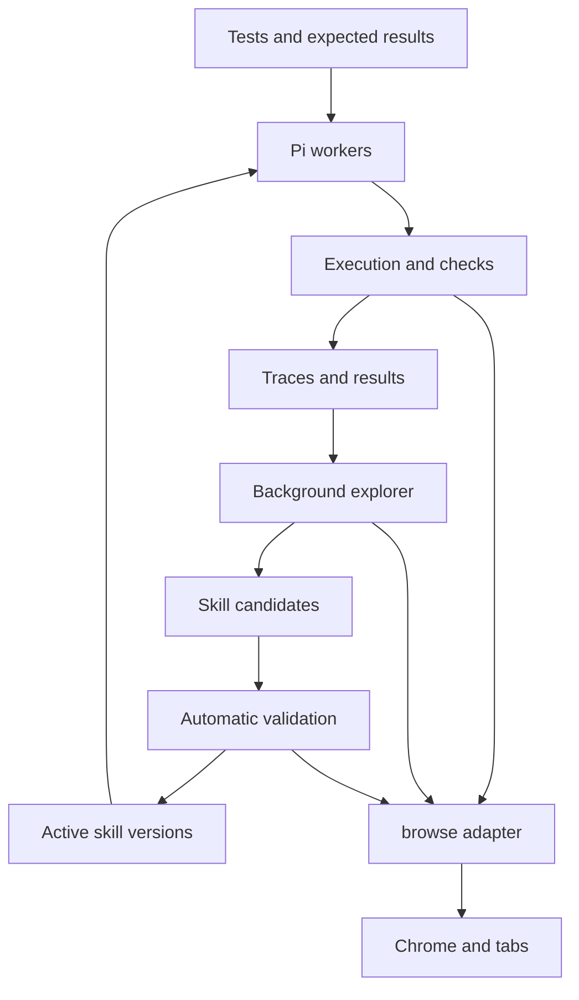

# Local UI skill learning for QA agents

Version 0.1. Discussion draft, 21 November 2026.

The goal is to reduce the number of LLM calls and the time it takes to obtain a correct UI test result by learning verified ways to interact with the interface. The original test defines what counts as success at each step. Those criteria apply every time a recipe is reused or recovered.

This specification describes a skill system for the existing QA agent built on Pi and opencode browse. Local skill trials can also run in an opencode session using the same browse installation.

The architecture uses the existing local Pi workers, one background explorer, a shared local log, and a versioned skill catalog. The system automatically decides when to validate, publish, roll back, or reinvestigate a skill. It operates without an external knowledge service.

## 1. Established requirements

| Area | Requirement |
| - | - |
| Corpus | About 10,000 step-by-step tests across roughly 10 enterprise platforms |
| Scenarios | Authors describe actions in detail using natural language and decide whether to specify expected results |
| Interfaces | Navigation, forms, CRUD, tables, filters, sorting, pagination, calendars, lists, autocomplete, trees, tabs, modal windows, file uploads, validation, loading states, errors, and permissions |
| Agent | A dedicated session in a custom Pi harness, with a system prompt, tools, and a limit on LLM calls |
| Models | The open models the team uses. The knowledge format allows the team to choose the model |
| Browser | opencode browse with the Rust runtime, Chrome, and MCP |
| Concurrency | Independent tests with one tab per worker, shared cookies, and a shared browser profile. The user has already verified this setup |
| Data | Preserve explicit values. Select or generate unspecified values according to the test rules |
| Explorer | Runs alongside the workers, analyzes traces, and can perform UI operations independently, including CRUD |
| Action restrictions | Respect configured restrictions and denials from the interface. Handle routine application confirmations automatically |
| Knowledge publication | Human participation is optional |
| Deployment | On each tester’s computer, with a local log, queue, and catalog |
| Platform updates | Currently about every six months. The architecture accommodates more frequent changes |

In version 1, a headless explorer is a background Pi session without an interactive terminal. It uses its own background tab in the existing browser. Running Chrome entirely without a window is an optional deployment choice.

## 2. Verified properties of opencode browse

The implementation reviewed here is commit `ae5d9d07ba8714bc34fa3ae5f5d899a0088e8782` on the `dev` branch. Testers may have a different version installed. The adapter checks the installed version and its MCP schemas before use.

browse uses a Rust relay, a Chromium extension, and CDP. It exposes individual browser tools and supports running JavaScript in QuickJS through `execute`. The tools exposed depend on the client and the `plain|execute|all` setting. State is associated with individual tabs. [README](https://github.com/anomalyco/browse/blob/ae5d9d07ba8714bc34fa3ae5f5d899a0088e8782/README.md), [architecture decisions](https://github.com/anomalyco/browse/blob/ae5d9d07ba8714bc34fa3ae5f5d899a0088e8782/rust/PLAN.md).

| Property | Integration consequence |
| - | - |
| Named tabs have protection against some overlapping calls. The lock lasts for one call | The harness assigns a tab to a job for the entire scenario. The built-in lock covers only an individual call |
| Snapshot refs depend on the document state and generation | Use refs during the current execution. Persist a way to resolve the target again in a reusable recipe |
| Multi-step execution is nontransactional | An error or timeout can leave partial effects. Check the current state before retrying |
| `execute` returns mixed output without a guaranteed QA-specific JSON contract | The adapter keeps the raw MCP result and produces its own typed result |
| The JavaScript shim supports a limited subset of a familiar API | Recipes depend on verified browse capabilities. Compatibility with another library’s entire API must be established explicitly |
| An ordinary snapshot can omit entered values | Read the relevant values separately to verify field contents. The presence of a field alone cannot establish that its value is correct |

Implementation sources for the table include the [relay tests](https://github.com/anomalyco/browse/blob/ae5d9d07ba8714bc34fa3ae5f5d899a0088e8782/rust/crates/browse-relay/src/tests.rs), [snapshot implementation](https://github.com/anomalyco/browse/blob/ae5d9d07ba8714bc34fa3ae5f5d899a0088e8782/rust/crates/browse-page/src/snapshot.rs), [target resolution](https://github.com/anomalyco/browse/blob/ae5d9d07ba8714bc34fa3ae5f5d899a0088e8782/rust/crates/browse-page/src/target.rs), [script runtime](https://github.com/anomalyco/browse/blob/ae5d9d07ba8714bc34fa3ae5f5d899a0088e8782/rust/crates/browse-script/src/lib.rs), and [page evaluation](https://github.com/anomalyco/browse/blob/ae5d9d07ba8714bc34fa3ae5f5d899a0088e8782/rust/crates/browse-page/src/eval.rs).

Modern Chrome supports extensions in its new headless mode. The browse headless test harness substitutes the extension transport. Its full stress harness runs headed Chrome on a virtual display. The specific combination of the extension and headless Chrome therefore needs a separate smoke test. [Chrome documentation](https://developer.chrome.com/docs/extensions/how-to/test/end-to-end-testing), [test support](https://github.com/anomalyco/browse/blob/ae5d9d07ba8714bc34fa3ae5f5d899a0088e8782/rust/crates/browse-page/tests/support/mod.rs), [stress launcher](https://github.com/anomalyco/browse/blob/ae5d9d07ba8714bc34fa3ae5f5d899a0088e8782/stress/exe/chrome.sh).

## 3. Proposed approach and alternatives

| Option | Advantage | Limitation |
| - | - | - |
| Text-only skills | A small change to the existing agent. UI details are easy to explain | The model still selects and issues most actions |
| Save entire tests as scripts | Few LLM calls for an exact repeat | Many similar scripts, costly adaptation, and a risk of losing intermediate checks |
| Concise instructions and short executable recipes | Reuse across scenarios, control over checks, and local recovery | Requires a recipe runner and automatic candidate validation |

Version 0.1 proposes the third option. The worker and explorer roles follow the division of work the user proposed. The short recipe format, local storage, and promotion rules below are design decisions for this draft.

The initial unit of knowledge is a recurring operation on a particular platform or within a component family. The framework is an additional attribute. Two platforms using Vue still need independent evidence that a skill applies to both. A skill’s scope expands after validation in new contexts.

In the first version, the harness executes saved sequences through the existing plain browse tools. This removes the LLM loop between known actions and keeps each action observable. Compiling the same recipe into one `execute` call is a later optimization. It requires verifying equivalent actions, checks, and handling of partial failures.

## 4. Local harness components



These components are modules of one local application and can run without separate servers.

**Coordinator.** Assigns tests and tabs, tracks budgets, starts background jobs, and restores the queue after a failure.

**Worker profile.** Runs the original test, looks up knowledge, selects parameters, applies recipes, and performs bounded exploration when necessary. It produces a result and supporting evidence for each step.

**Explorer profile.** Analyzes traces, creates candidates, and runs targeted experiments. It produces a versioned knowledge entry and material for independent validation. It can use the same model as the worker.

**Recipe runner and assertion runner.** Execute operations and check required states. The harness stores the original test assertions separately from the editable recipe.

**Browse adapter.** Normalizes the actual MCP contract, binds calls to the assigned tab, and logs individual actions and observations. It uses existing browse selectors and actions.

**Knowledge store and experience store.** Hold skill versions, indexes, metrics, the exploration queue, traces, and references to local evidence.

**Validator.** Runs as an automatic harness job. It can run an ordinary worker in a fresh session to validate a candidate and use the explorer for diagnostics. The check results determine whether the candidate qualifies.

## 5. Test contract and immutable assertions

The harness stores the original test text with its hash and stable step IDs. For each step, it records `source_text`, the action, the data selection rule, the expected results, and references to evidence.

Conversion from natural language to a structured plan must preserve every part of the original text. Each part of an expected result receives an assertion ID or an explicit status indicating that it cannot yet be checked automatically. Counting assertion IDs alone cannot establish that the interpretation is complete.

The existing test verification mechanism stays in place. Programmatic checks cover precise properties such as a field’s value, the presence of a record with the required ID, the count of selected items, a control’s disabled state, or a message’s visibility. A model may assess a visual or semantic condition using a specific observation and a reference to the original requirement.

A step without an expected result has an empty assertion list. Its trace records the action and the observation. For example, the trace can record that an error page appeared after a form submission. Only the scenario’s conditions can determine how to judge that outcome.

A step receives `UNVERIFIED` when the available evidence cannot establish its stated expectation. Any unverified mandatory condition precludes PASS. The harness calls a separate LLM verifier only where programmatic checks are insufficient.

The recipe runner can have operational postconditions, such as a list having opened. The assertion runner separately checks scenario requirements, such as the absence of an unavailable option. The explorer can change how it finds elements. The original expected results are immutable.

A recipe preserves the actions, order, and expected results specified in the scenario. If the scenario requires clicking a button, the recipe locates that button and clicks it.

Each contract revision fixes the text and assertion ID, whether the condition is mandatory, the subject of the check, the executable predicate, the expression for the expected value, the evidence collection method, the checkpoint, and the permitted wait window. A linked recipe cannot change any of these fields. For example, a requirement that the saved date equal the entered date rules out substituting a check that the field contains any value.

The test intake module creates the contract before learned recipes are applied. The explorer has no tool to edit it. Changing the original test creates a new revision. A separate automated process can update the compiler or evaluator against a fixed regression suite. Completed attempts retain their original records.

An ambiguous expectation receives `unresolved_interpretation`. The agent can collect more observations and issue a diagnostic result. Such a condition cannot support a PASS or justify publication of a skill. For an LLM check, the evaluator receives the original expectation and independent observations, without the recipe author’s claim of success. This reduces the risk of correlated errors. How completely the evaluator interprets natural language still needs to be tested independently of the format.

The start and duration of the wait are set before the action. If an eventual result has yet to appear before its deadline, its status is pending. Once the deadline passes, the harness records a mismatch or insufficient evidence. Reading again cannot extend the deadline. A test requirement for an immediate result retains its original timing.

## 6. Parameters and test data

For each value, the harness records the selection rule, the value actually used, and when it was bound. Recipes take parameters. Values from the training trace do not become constants in a recipe.

| Test rule | Behavior |
| - | - |
| Explicit value | Use exactly the specified value |
| Random string of a given length | Generate it within the field constraints and record the seed and actual string |
| Timestamp or current date | Fix the test’s base time and time zone and calculate derived values from that base |
| First or last option | Read the current ordered set and record the selected ID and label |
| Any matching record | Select a record using the test conditions and retain its identity for subsequent checks |

The last visible row in a virtualized list does not establish the last option in the entire set. If the list has loaded only partially, use the available UI actions to obtain the required set or mark the selection condition as unverified.

Entities created during the test use a namespace scoped to the user, run, and job unless the test requires a different name. Cleanup affects only entities known to have been created. Operations on an existing record retain its ID. Recovery prohibits arbitrarily substituting another record if that would change the meaning of the test.

Bindings belong to a particular attempt. The random value and base time are bound at first use as prescribed by the rule. Local recovery preserves both. If the test explicitly requires a fresh current time at each step, each such value gets its own binding in accordance with the test text. Real elapsed time and deadlines are measured independently of the frozen test time.

Selection from a live list occurs immediately before the action. If the set changes before any action or check uses the binding, the harness may select again and record a separate log event. Once used, the binding fixes the identity. If the record disappears, the harness cannot silently substitute an adjacent one.

A new attempt with the initial state restored re-evaluates dynamic rules and receives fresh bindings. Explicit values in the original test remain fixed. Exact replay of a past attempt with its saved bindings is a separate diagnostic mode identified in the report.

The validator varies data only within the rules of the original test. For a test with exact values, it uses a different existing test or creates a separate `ValidationContract` for a trial with its own conditions and provenance. The trial result is reported under its own contract and cannot count as execution of the unchanged original test.

## 7. Knowledge model

The catalog holds four kinds of information.

1. General UI interactions include focusing an element, entering a value, selecting an option, expanding a control, waiting, and reading state.
2. Component variants include comboboxes, multiselects, date ranges, virtualized tables, trees, and verified behaviors of a particular library.
3. Platform knowledge covers navigation, forms, tables, composite operations, and the behavior of business entities.
4. Current bindings identify the tab, snapshot refs, open form, and selected records. They live in the session and never become persistent locators.

The package follows the Agent Skills model of a small `SKILL.md` file with additional resources and optional code. The harness owns the quality contract and executes the skill. [Agent Skills specification](https://agentskills.io/specification).

| Version artifact | Contents |
| - | - |
| `SKILL.md` | Purpose, when to use the skill, important limitations, and example parameters |
| `manifest.json` | ID, version, scope, parameters, dependencies, required runtime capabilities, effect type, and retry rules |
| `recipe.json` (optional) | Executable sequence with limited branching and checkpoints |
| `validation.json` | Checks, independent results, covered variants, and reasons for failure |
| Evidence links | Traces, observations, and results. Full logs stay outside the skill context. |

A note in `SKILL.md` suffices for a verified UI behavior. Add an executable recipe when the same sequence of actions recurs and running it through browse saves model calls. Both forms of skill use the same catalog and publication process.

A new package starts with a narrow scope defined by the platform, page or widget, user role, and relevant configuration. Include the locale and the application and library versions when they affect behavior. Record an unknown version as unknown. A single CSS class cannot establish it.

Applicability depends on observable features such as component type and role, the nearest container, available actions, related fields, states, and verified behaviors. A full DOM hash cannot serve as the sole key. Labels, test IDs, and structure can help resolve a target. The action must still go through the UI under test.

## 8. Executable recipes

The first version supports a limited set of actions: `observe`, `act`, `check`, `branch`, `repeat` with a finite limit, and `call_recipe`. This representation is internal to the harness. It uses the existing opencode browse API, browser engine, and selectors.

Each `act` node resolves to the name and arguments of an actual browse tool. An `observe` node uses a registered probe to take a snapshot or screenshot or read a specific DOM property. The `check` and `branch` nodes use typed predicates over observations to test equality, membership, visibility, state, count, or agreement with a binding. Both an iteration count and a total time limit bound `repeat`. Dependencies between `call_recipe` nodes form an acyclic graph with pinned revisions. The first version's required intermediate representation excludes arbitrary JavaScript.

A recipe call includes the range of original step IDs and the exact positions of mandatory assertions. If the harness cannot establish how the recipe's actions map to those checkpoints, the worker executes that part of the scenario normally. The input method must also preserve the test's meaning. For example, testing keyboard events requires keyboard input. Assigning a DOM value would skip those events.

Each action maps to an existing browse tool, and the recipe stores a parameterized method for resolving the target. The harness inserts mandatory test checks at their original step IDs. Recipe changes cannot remove them. Branches depend on observed state. If the state is uncertain, control returns to the worker.

This example illustrates the contract. It is not a working implementation.

```json
{
  "id": "platform-a.form.select-option",
  "revision": "1",
  "scope": {"platform": "platform-a", "component": "combobox"},
  "parameters": ["container", "field", "selection_rule"],
  "preconditions": ["container_visible", "field_unique"],
  "effects": "ui_state_change",
  "retry": "observe_before_retry",
  "steps": [
    {"kind": "act", "operation": "open_field", "target": "$field"},
    {"kind": "observe", "target": "associated_options", "bind": "options"},
    {"kind": "act", "operation": "select_option", "rule": "$selection_rule"},
    {"kind": "check", "condition": "selected_value_matches_binding"}
  ]
}
```

The recipe returns the actions performed, actual parameter bindings, observations, results of its operational checks, the stopping point, and the status of its effects (`none`, `known_partial`, `completed`, or `unknown`).

For example, a test requires the worker to open a form, verify that a button is disabled, fill in a field, check a counter, select an option, save, and see the record. Each check remains a separate checkpoint even when a single recipe executes the sequence. Reducing this test to “fill in everything and save” would skip required checks.

A later `execute` backend could generate JavaScript for QuickJS from the same recipe and return the same events. Before using it for a particular recipe, verify equivalent behavior, time limits, and correct handling of a partially executed sequence.

## 9. Finding and loading knowledge

Before the LLM makes a selection, the harness filters the catalog by platform, page, operation type, user role, browse capabilities, and version status. It then ranks results by relevance to the task, verified applicability, robustness, and observed cost.

The initial implementation uses structured fields and SQLite full-text search. Add vector search only if the pilot shows that variations in wording cause retrieval to miss relevant recipes.

The worker receives a short list of descriptions. The agent decides whether to use a skill for the current step. If it selects one, it reads the instructions and calls the attached recipe when needed. The system prompt omits the full cross-platform catalog. If there is no suitable candidate, the worker can execute the step normally.

Before applying a skill, the harness checks its preconditions. A scope mismatch yields `NOT_APPLICABLE` and does not establish a product defect. If a change affects the test's expected result, a fingerprint mismatch cannot explain it away.

The framework and component library help with retrieval. Applicability still requires verification. A recipe transferred from another platform remains a candidate for the new scope until its behavior there has been verified.

The `scope` records confirmed contexts and, separately, hypotheses about where the skill might transfer. The platform, route or page template, component contract, and behavior-affecting variants define a context. Specific IDs of newly created objects do not by themselves define a new context.

If features match on a new form, the system can propose an existing recipe as a candidate and automatically validate it in that context. If the first trial also serves as a working test, the harness marks it as a candidate execution, runs the full assertion runner, and counts it separately from ordinary uses of an active skill.

Success on two forms does not establish applicability to every Vue interface. Adding a confirmed context requires the same checks as initial publication. In the first version, a broad scope defined only by a framework or component library helps identify possible transfers. Active use requires a confirmed context.

## 10. Main worker loop

1. Obtain the test, its original contract, a tab, the overall budget, and a snapshot of active skill versions.
2. Prepare data and check the test's initial conditions.
3. Find a recipe for the next part of the scenario, check applicability, and bind the parameters.
4. Perform the actions, run the mandatory checks at their checkpoints, and record evidence.
5. If no recipe is available, run that part of the scenario through the usual agent loop.
6. If an element cannot be resolved locally, investigate within the remaining budget.
7. Record each step's result, the final verdict, and episodes for the explorer.

The main agent can propose a local addition or a new candidate. It submits the proposal through the candidate tool, which preserves the active version.

The LLM call budget applies to the entire test, including any explorer invoked synchronously. Starting a child session does not reset the limit. Time, browser action count, retries, and output size have their own limits so that one LLM call cannot start an unbounded tool loop.

The harness detects a lack of progress when the action, target, error, and relevant state recur together. A retry requires new information or a predefined wait condition. When the budget runs out, the harness records the stopping point and the evidence.

## 11. Explorer workflow

The explorer draws tasks from three sources: verified segments of successful execution, costly recurring operations, and local failures. A correctly completed early segment can be useful even if the test later uncovers a defect.

Clicking a visible button or section is an ordinary browse action. The number of times that click recurs is insufficient on its own to justify a skill.

A low-cost programmatic filter groups recurring episodes by operation and context. Logging an entry does not trigger an LLM call for every row. The explorer processes the queue in small jobs, starting with frequently used operations likely to yield savings.

The explorer follows these steps.

1. Take a recurring episode or an unverified branch.
2. Check whether an equivalent skill already exists.
3. Distinguish parameters, preconditions, and checkpoints from incidental trace details.
4. Create a narrowly scoped candidate and describe where it applies.
5. Schedule targeted trials, such as using a different text length, an empty list, an ambiguous label, an alternative state, or a different container.
6. Perform permitted UI actions on the explorer's own data and submit the candidate to the validator.

Each active trial answers a specific question. Onboarding a platform does not require surveying every page without a specific objective. The most uniform platform and its frequent operations provide the initial knowledge.

The explorer can create, modify, and delete entities. Its trial data gets distinct identifiers. It must coordinate before changing a record that a worker is using. In the occasional case of a shared setting or an existing entity in shared use, the coordinator grants temporary ownership of the resource or postpones the trial.

The explorer distinguishes a DOM modal, a native JavaScript dialog, and a browse handoff. It handles ordinary confirmations of permitted operations automatically. It records a denial message and respects the denial. If a negative test expects the denial, the check can succeed. Expired authentication or a mandatory external confirmation is recorded as an environment blocker. These constraints also apply when skill publication is automated.

## 12. Automatic validation and publication

A version can be `candidate`, `validated`, `active`, `quarantined`, or `retired`. Versions are immutable. A correction creates a new revision, and all state transitions are automatic.

**Static validation** checks the schema, parameter types, permitted operations, finite limits, and dependencies. It also checks that the package contains no saved runtime refs, secrets, or specific data from the training run.

For a textual instruction, validate the UI behavior it describes in the stated context. For example, a claim that search starts at three characters requires observations on both sides of the threshold. This requirement applies only to the validation trial for that instruction.

**Independent replay** runs in a new session with the initial state restored and different permitted values. Completing a run without an exception is insufficient for the explorer to mark its own recipe as validated. Validation verifies actual state transitions and the mandatory expected results of the original tests.

**Variant checks** cover all branches and situations the recipe claims to support. An uncovered variant must be excluded from scope or the candidate remains unvalidated. In the first version, validation requires at least three independent attempts, each with a freshly prepared initial state, confirmation of every mandatory condition, and at least two datasets whenever the contract permits variation. If the contract specifies exact data, repeat the trials using those values. This operational threshold does not establish statistical reliability.

**Test quality checks** use controlled faults where local fixtures can be prepared. Examples include a missing record, an incorrect value, a broken button, and a required validation error that fails to appear. The recipe must preserve the test's ability to detect these discrepancies. Fixtures supplement validation on the actual platform, which remains mandatory.

Even without a product fixture, the recipe must pass static validation, replay on the real UI, full verification of the original conditions, and checks of every declared branch. Separate negative examples for the assertion runner check that the evaluator rejects a mismatch between expected and observed values. These examples exercise the evaluator without simulating a defect across the whole platform. Publication is limited to the narrow, verified scope, and the lack of broader coverage is explicitly recorded.

**Publication** atomically points the active version reference to the new version. A test already in progress continues to use its pinned version. The first uses of a new version run the full set of checks. Mandatory assertions continue on all subsequent uses.

**Quarantine and rollback** are triggered by a confirmed false PASS, a contract violation, or an incompatible recipe. An ordinary product error alone does not lower the recipe's rating. If the cause is unclear, a version may be suspended pending automatic diagnosis. The worker reverts to the previous compatible version or resumes ordinary execution.

Insufficient evidence leaves the candidate unpublished, narrows its scope, or triggers more automatic checks. It does not create a manual approval queue.

## 13. Recovery and test results

Within the test contract, the worker may refresh a stale element binding, read the state again, or refine how it waits for readiness. It must never adopt a missing expected result as the new baseline, delete an assertion, suppress an error without checking it, or bypass the UI action under test through a backend API.

| Situation | Action |
| - | - |
| The element could not be resolved and the UI has not yet changed | Observe again and attempt local recovery within the budget. |
| Several elements match | Refine the container and identifying features. Do not choose arbitrarily. |
| An action was partially executed | Record completed substeps and check the actual state. |
| A timeout occurred after form submission | Check the submission outcome before retrying to avoid creating a duplicate. |
| The expected state is absent | Record the violation and its evidence. Further diagnosis must preserve the original result. |
| Observations are insufficient to draw a conclusion | Finish with INCONCLUSIVE. |
| The environment is unavailable, or a required action is denied outside the conditions of a negative test | Report BLOCKED or FAIL according to the specific expected result. |

The result records two independent fields. The `verdict` is PASS, FAIL, BLOCKED, or INCONCLUSIVE. The `cause` is product, automation, environment, or unknown. Mandatory conditions separately record observed_match, observed_mismatch, unverified, or not_reached.

PASS requires confirmation of every mandatory condition. FAIL requires an observed violation of an expected result. A timeout alone does not establish a product defect. A successful new attempt links to the original attempt and preserves its history.

Local recovery belongs to the same attempt if it preserves bindings already used, avoids resetting the scenario, and respects the required order, deadlines, and checks. Restarting from the initial state, switching the subject of the test after it has been used, or continuing execution after a recorded violation starts a new `test_attempt`. A PASS must never combine evidence from different attempts.

In the final run report, even one reliably observed violation of an original condition preserves the overall FAIL. A later successful attempt adds the flag `flaky_or_recovered_after_failure`. If no violation occurred and one attempt confirmed all conditions, the run may receive PASS. The report shows earlier incomplete attempts as recovered automation or environment failures. Without a fully successful attempt, the result remains BLOCKED or INCONCLUSIVE according to the reason execution stopped.

If the observation itself or the evaluator is later shown to be invalid, the attempt receives the flag `invalid_evidence` and a verdict of INCONCLUSIVE. The original record is preserved, and the attempt cannot become PASS. Statistics separately track first attempts, all attempts, final results, and flakiness.

## 14. Traces and hooks

Each action record contains at least `run_id`, `test_id`, `step_id`, `worker_id`, `tab_id`, the event number and timestamp, the recipe and its revision, the resolved parameters, the observation before the action, the operation invoked, the raw MCP result, the observation after the action, the assertion results, and the error category.

The harness records an event when a job starts, a recipe is selected, a precondition is checked, a target is resolved, an action starts or ends, an observation is obtained, an assertion is checked, execution stops, a test result is produced, or a candidate is proposed. Traces reference full snapshots. The model receives only the excerpts it needs.

Before each call, a hook checks the tab binding, budget, parameters, version, and whether the action is permitted. After the call, a hook records the actual result and runs the required checks. At the end of each step, the harness records which expected outcomes were checked. At the end of the test, it publishes the result and sends messages to the explorer.

Internal recipe operations go through the same tool dispatcher. When a backend uses a single browse `execute` call, external Pi hooks alone cannot capture the checkpoints. The compiled recipe must emit separate events and evidence for them. An incomplete trace cannot establish the verification needed to promote a skill.

The runner requires evidence beyond a “success” message. The adapter checks `isError`, parses supported output formats, and retains the raw response. A parse error leaves the outcome unknown. After a timeout, the runner accounts for the possibility that the action is still in progress before calling it again.

Recipes and the explorer’s context exclude secrets and authorization data. The harness retains entered test values only to the extent needed to reproduce the run and handles sensitive fields separately.

## 15. Local storage and concurrency

The proposed storage design uses SQLite in WAL mode for metadata and queues, with local files for immutable packages and large evidence artifacts. Writes use short transactions. Publishing the active revision is atomic. A separate database server is optional.

The minimum set of tables comprises `runs`, `test_attempts`, `step_results`, `events`, `skills`, `skill_versions`, `validation_runs`, `exploration_jobs`, `tab_leases`, `resource_leases`, and `artifacts`.

Before scenarios start, worker 0 signs in and prepares the shared browser context. Each worker opens its own tab in that context. The platform described here defaults to English and also supports Chinese. After a language change, other tabs show the new language when refreshed. Each tab identifier includes the run and the worker. The tab belongs to its job for the full assignment, including pauses between MCP calls. Any child tabs it opens belong to the same job. Neither a framework skill nor a catalog file owns a browser tab.

By default, one explorer runs at a lower priority than test workers. When the computer is busy, the explorer either continues lightweight log processing or waits. Active probes have a separate budget. The total cost of testing includes the explorer’s time and tokens.

After a restart, the harness reads the log, checks that the tabs still exist, and inspects the state of unfinished actions. A saved tab ID alone cannot establish that the browser still holds the same document. If a form submission was in progress, the harness first observes its outcome.

The design includes size limits for the log and evidence, deletion when the retention period expires, and an explicit list of artifacts needed to reproduce active skills. Transferring knowledge between computers is optional in the first version. An imported package enters the local environment as a candidate.

## 16. UI and runtime updates

The harness records the browse version, available tools, and supported parameters. If the version is unavailable, it records a fingerprint of the schemas. Each recipe declares the capabilities it requires. After a runtime change, the harness runs a short compatibility smoke test before using recipes that depend on it.

When the platform exposes a build ID, the harness uses it to track the platform version. Otherwise, the harness detects drift when applicability conditions fail or relevant behavior changes. Routine testing can proceed without a known version number.

A component update triggers quarantine for the affected variants, their dependencies, and versions. More general skills remain available as long as they are compatible.

The harness distinguishes behavioral drift from product defects. A new way to select a date may require a new recipe. Saving the wrong date still violates the test expectation.

## 17. Evaluation

The primary metric is the cost of obtaining a correct verdict while retaining the ability to detect defects. The PASS rate alone cannot measure quality.

Compare four modes using the same model, data, browser, and budgets: the baseline agent, instructions only, executable recipes only, and the hybrid. Also measure the system with the background explorer enabled.

| Group | Metrics |
| --- | --- |
| Quality | False PASS verdicts, detection of known defects, false FAIL verdicts, proportion of INCONCLUSIVE verdicts, and coverage of mandatory assertions |
| Speed | p50 and p95 time to verdict, and throughput on the local computer |
| Cost | LLM calls, input and output tokens, tool calls, browser time, and the full cost of exploration including validation |
| Knowledge | Proportion of retrieved recipes that apply, precondition failures, useful instances of reuse, rollbacks, and the scope over which transfer has been verified |
| Resilience | Partial failures, duplicated effects, and recovery after DOM changes and restarts |

The initial pilot targets approximately 200 representative tests grouped by operation family. The exact number depends on the available corpus. Split training and holdout scenarios by template and workflow. Randomly separating rows from the same template is insufficient.

For a fixed-memory evaluation, freeze the catalog before the holdout run. For online learning, separately record the task order, the knowledge available at each step, and all training costs. Report the two evaluations separately.

Measure whether each skill pays for itself. Cumulative savings from subsequent uses must exceed the costs of synthesis, validation, and maintenance. Evaluate correctness independently of token savings.

The initial release requires zero new false PASS verdicts on the prepared set of controlled defects, an explicit result for every mandatory condition, and zero duplicate effects in rerun scenarios. The hybrid must also show a measurable improvement on a total-cost metric selected in advance. Set a numerical speedup target after measuring the baseline. Until measured, a target is not evidence of an achieved speedup.

## 18. Implementation stages

| Stage | Deliverable | Condition for advancing |
| --- | --- | --- |
| 1 Observability | Normalized browse adapter, step-by-step traces, and a baseline | Actions map to expectations, and tool errors cannot produce a PASS |
| 2 Working with memory | Local catalog, retrieval, and access to concise skills | The agent finds useful knowledge without loading the entire catalog |
| 3 Recipes | Host runner and recipes for the first frequently used operations | The runner preserves intermediate checks and handles partial failures correctly |
| 4 Trace-based explorer | Automatic extraction and validation of candidates | Candidates move through validation to publication without human intervention |
| 5 Active probes | The explorer tests missing variants in its own tab | Probes preserve the independence of running tests and stay within budget |
| 6 Transfer and optimization | Verification on a second platform and selective use of the `execute` backend | Applicability has been verified and the return on investment measured |

In this example, signing in and switching to Chinese happen once during browser setup. The scenario from the corporate environment, as recalled from memory, then directs the worker to follow a link in the browser, open the form for creating a requirement, fill in the fields (including dates and dropdowns), export a file, and click “Create.” The development computer has no access to the platform. These operations guide the pilot. The details of widget behavior and the benefits of the skills still need verification on the platform.

Possible first recipes include selecting from lists, filling out recurring forms, filtering tables, finding a newly created record, and working with dates. Frequency and cost in real traces determine the final priorities.

Ordinary agent execution remains available at every stage, including on platforms without a published skill.

## 19. Verifiable readiness requirements

1. A worker can run a test with an empty catalog and save a trace suitable for analysis.
2. The explorer creates a parameterized candidate that contains neither the concrete values nor the refs from the original run.
3. The validator replays the candidate with different data and requires evidence of success beyond the absence of exceptions.
4. Publication and rollback proceed without requesting human confirmation.
5. A test in progress continues to use its pinned revisions even after a new version is published.
6. Using a recipe preserves the intermediate assertions in the original test.
7. If the UI function under test is broken, a workaround cannot turn the result into a PASS.
8. After a partial failure or timeout, the system checks the effect before repeating a non-idempotent action.
9. Two independent workers use different tabs with shared cookies. The explorer leaves their pages under their control.
10. The application may indicate that an operation is forbidden or show an ordinary confirmation prompt. The handler distinguishes a refusal, a confirmation, and a handoff.
11. The LLM call limit covers the entire test and its synchronous subtasks. Additional limits bound actions that do not call the LLM.
12. Updating a component or browse triggers a compatibility check and invalidates the affected knowledge.
13. The system keeps the holdout set separate from training and includes the full cost of the explorer in its report.
14. All artifacts reside and all processes run on the tester’s computer. The system can operate without a shared remote registry.

## 20. Rationale and scope

Agent Workflow Memory studies how to extract recurring, parameterized procedures from trajectories and accumulate them both offline and online. SkillWeaver studies how an agent can synthesize its own libraries of actions for websites. These studies support the proposed direction. Performance with the team’s open models and defect detection quality on this corpus remain to be established. [AWM](https://arxiv.org/html/2409.07429v1), [SkillWeaver](https://arxiv.org/html/2504.07079v1).

Appendix D.2.1 of SkillWeaver describes a verification failure. A function could be accepted after it ran without an exception even though conditions added to the function caused it to skip necessary actions. This specification therefore requires verification of the observed state against the original test expectations before a skill can be accepted.

The architecture can operate without an exhaustive catalog of UI states. It accumulates bounded skills with explicit conditions for use, measures their benefit, and resumes exploration when new knowledge is needed.

During the first integration stage, verify the actual schemas of the installed browse version, the existing mechanism for checking expected results, the available way to restore the initial data, and fully headless Chrome if needed. These checks fit within the proposed local architecture.
