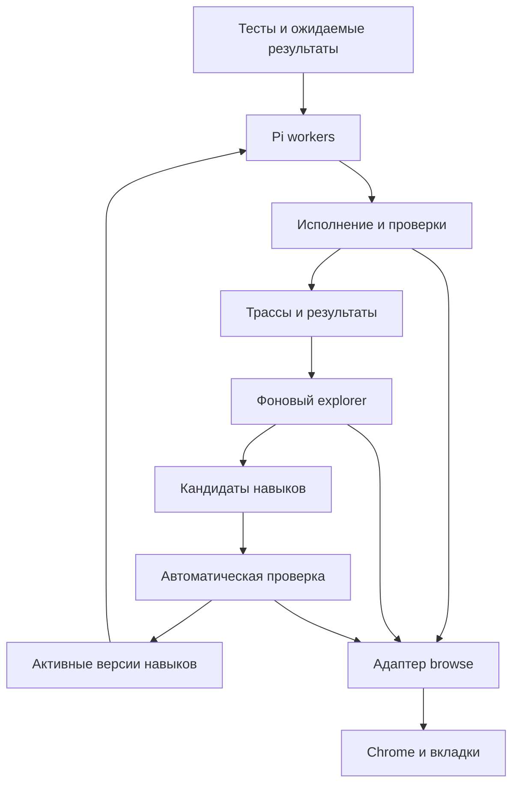

Версия 0.1. Проект для обсуждения. 21 ноября 2026 года.

Цель — сократить число обращений к LLM и время получения корректного результата UI теста за счёт накопления проверенных способов взаимодействия. Критерии успешности каждого шага берутся из исходного теста и сохраняются при любом переиспользовании или восстановлении рецепта.

Предмет разработки — система навыков для существующего QA-агента на Pi и opencode browse. Для локальных проб навыков можно использовать сессию opencode с тем же browse.

Базовая архитектура: существующие локальные Pi workers, один фоновый explorer, общий локальный журнал и версионированный каталог навыков. Все решения о проверке, публикации, откате и повторном исследовании навыков принимаются автоматически. Подключение внешнего сервиса знаний не требуется.

# 1 Зафиксированные требования

| Область | Требование |
| - | - |
| Корпус | Около 10 000 пошаговых тестов для примерно 10 корпоративных платформ |
| Сценарии | Естественный язык, подробные действия; ожидаемый результат указывается по усмотрению автора сценария |
| Интерфейсы | Навигация, формы, CRUD, таблицы, фильтры, сортировка, пагинация, календари, списки, autocomplete, деревья, вкладки, модальные окна, загрузка файлов, валидация, состояния загрузки, ошибки и разрешения |
| Агент | Отдельная сессия кастомного Pi harness, системный промпт, инструменты и лимит LLM вызовов |
| Модели | Используемые командой открытые модели; выбор модели не зафиксирован в формате знаний |
| Браузер | opencode browse с Rust runtime, Chrome и MCP |
| Параллельность | Независимые тесты, отдельная вкладка на worker, общие cookies и браузерный профиль; эта схема уже проверена пользователем |
| Данные | Явные значения сохраняются; неуказанные выбираются или генерируются по правилам теста |
| Explorer | Работает рядом с workers, анализирует трассы и может самостоятельно выполнять UI операции, включая CRUD |
| Ограничения действий | Соблюдает заданные ограничения и отказы интерфейса; обычные подтверждения приложения обрабатывает автоматически |
| Публикация знаний | Без обязательного участия человека |
| Развёртывание | На компьютере каждого тестировщика; журнал, очередь и каталог локальны |
| Обновления платформ | Сейчас примерно раз в полгода, архитектура допускает более частые изменения |

Под headless explorer в первой версии понимается фоновая сессия Pi без интерактивного терминала, работающая в собственной фоновой вкладке существующего браузера. Полностью безоконный Chrome является отдельным вариантом развёртывания и не нужен для основного контура.

# 2 Проверенные свойства opencode browse

Источники реализации изучены на ветке dev, commit `ae5d9d07ba8714bc34fa3ae5f5d899a0088e8782`. Это описание исследованного среза, а не утверждение о версии, установленной у тестировщиков. Перед работой адаптер сверяет фактическую версию и MCP схемы.

В browse используются Rust relay, расширение Chromium и CDP. Доступны отдельные браузерные инструменты и выполнение JavaScript в QuickJS через `execute`; набор выдаваемых инструментов зависит от клиента и настройки `plain|execute|all`. Состояние связано с вкладками. [README](https://github.com/anomalyco/browse/blob/ae5d9d07ba8714bc34fa3ae5f5d899a0088e8782/README.md), [архитектурные решения](https://github.com/anomalyco/browse/blob/ae5d9d07ba8714bc34fa3ae5f5d899a0088e8782/rust/PLAN.md).

| Свойство | Следствие для интеграции |
| - | - |
| Именованные вкладки защищаются от некоторых перекрывающихся вызовов; блокировка действует на вызов | Харнесс закрепляет вкладку за заданием на весь сценарий; встроенная занятость не заменяет эту привязку |
| Snapshot refs связаны с состоянием и поколением документа | Refs используются в текущем исполнении; долговременный рецепт хранит способ повторного разрешения цели |
| Многошаговое выполнение не является транзакцией | После ошибки или таймаута возможны частичные эффекты; повтор проверяет текущее состояние |
| `execute` возвращает смешанный вывод, а не гарантированный JSON контракт QA | Адаптер сохраняет сырой MCP результат и формирует собственный типизированный результат |
| JavaScript shim предоставляет ограниченное подмножество знакомого API | Рецепты зависят от проверенных возможностей browse, без неявной совместимости с полным API другой библиотеки |
| Обычный snapshot может не включать введённые значения | Проверка заполнения читает необходимые значения отдельно; наличие поля не доказывает корректность его содержимого |

Источники таблицы: [relay tests](https://github.com/anomalyco/browse/blob/ae5d9d07ba8714bc34fa3ae5f5d899a0088e8782/rust/crates/browse-relay/src/tests.rs), [snapshot](https://github.com/anomalyco/browse/blob/ae5d9d07ba8714bc34fa3ae5f5d899a0088e8782/rust/crates/browse-page/src/snapshot.rs), [target resolution](https://github.com/anomalyco/browse/blob/ae5d9d07ba8714bc34fa3ae5f5d899a0088e8782/rust/crates/browse-page/src/target.rs), [script runtime](https://github.com/anomalyco/browse/blob/ae5d9d07ba8714bc34fa3ae5f5d899a0088e8782/rust/crates/browse-script/src/lib.rs), [page evaluation](https://github.com/anomalyco/browse/blob/ae5d9d07ba8714bc34fa3ae5f5d899a0088e8782/rust/crates/browse-page/src/eval.rs).

Современный Chrome допускает расширения в новом headless режиме. В browse найден headless тестовый стенд с подменой транспорта расширения, а полный stress стенд запускает headed Chrome на виртуальном дисплее. Поэтому работоспособность конкретной связки extension плюс headless Chrome требует отдельного smoke test. [Chrome](https://developer.chrome.com/docs/extensions/how-to/test/end-to-end-testing), [test support](https://github.com/anomalyco/browse/blob/ae5d9d07ba8714bc34fa3ae5f5d899a0088e8782/rust/crates/browse-page/tests/support/mod.rs), [stress launcher](https://github.com/anomalyco/browse/blob/ae5d9d07ba8714bc34fa3ae5f5d899a0088e8782/stress/exe/chrome.sh).

# 3 Выбранный подход и альтернативы

| Вариант | Преимущество | Ограничение |
| - | - | - |
| Только текстовые skills | Небольшое изменение существующего агента, удобное объяснение особенностей UI | Модель продолжает выбирать и выдавать большинство действий |
| Сохранение целых тестов как скриптов | Мало LLM вызовов при точном повторении | Много похожих скриптов, дорогая адаптация, риск потери промежуточных проверок |
| Краткие инструкции и короткие исполняемые рецепты | Переиспользование между сценариями, управляемые проверки и локальное восстановление | Нужны исполнитель рецептов и автоматическая проверка кандидатов |

Для проекта предлагается третий вариант. Разделение workers и explorer соответствует предложенной пользователем организации работы. Формат коротких рецептов, локальное хранилище и правила продвижения ниже являются проектными решениями версии 0.1.

Начальная единица знаний — повторяющаяся операция конкретной платформы или семейства компонентов. Framework хранится как дополнительный признак. Общий Vue сам по себе не считается доказательством применимости навыка к другой платформе. Расширение области действия производится после проверки на новых контекстах.

В первой версии сохраняемая последовательность исполняется харнессом через существующие plain tools browse. Это убирает LLM цикл между известными действиями и сохраняет наблюдаемость. Компиляция в один `execute` — последующая оптимизация того же рецепта после проверки эквивалентности действий, проверок и обработки частичного отказа.

# 4 Компоненты локального харнесса



Это модули одного локального приложения, а не требование создавать отдельные серверы.

**Coordinator** выдаёт тесты, закрепляет вкладки, отслеживает бюджеты, запускает фоновые задания и восстанавливает очередь после сбоя.

**Worker profile** выполняет исходный тест, ищет знания, выбирает параметры, применяет рецепты и проводит ограниченное исследование при необходимости. Выход — пошаговый результат с доказательствами.

**Explorer profile** анализирует трассы, создаёт кандидатов и выполняет целевые эксперименты. Выход — версия знания и материал для независимой проверки. Отдельная модель не обязательна.

**Recipe runner и assertion runner** выполняют операции и проверяют требуемые состояния. Проверки исходного теста хранятся отдельно от изменяемого рецепта.

**Browse adapter** нормализует реальный MCP контракт, привязывает вызовы к вкладке, регистрирует отдельные действия и наблюдения. Он использует существующие селекторы и действия browse.

**Knowledge store и experience store** содержат версии навыков, индексы, метрики, очередь исследований, трассы и ссылки на локальные доказательства.

**Validator** является автоматическим заданием харнесса. Для проверки кандидата он может запускать обычный worker в новой сессии и использовать explorer для диагностики, но окончательный допуск зависит от результатов проверок.

# 5 Контракт теста и неизменяемые проверки

Исходный текст теста сохраняется вместе с хешем и стабильными идентификаторами шагов. Для каждого шага ведутся `source_text`, действие, правило выбора данных, ожидаемые результаты и ссылки на доказательства.

Преобразование естественного языка в структурированный план не должно выкидывать части исходного текста. Каждый фрагмент ожидаемого результата получает assertion ID либо явный статус, что его ещё нельзя проверить автоматически. Количество записанных assertion IDs само по себе не доказывает полноту интерпретации.

Существующий механизм проверки тестов сохраняется. Для точных свойств добавляются программные проверки: значение поля, наличие записи с нужным идентификатором, число выбранных элементов, состояние disabled, видимость сообщения. Для визуальных или семантических условий допускается оценка моделью с конкретным наблюдением и ссылкой на исходное требование.

Если ожидаемый результат у шага отсутствует, список его проверок остаётся пустым. В трассе сохраняются выполненное действие и наблюдение. Например, после отправки формы можно записать появление страницы ошибки. Оценка этого исхода возможна только по условиям сценария.

Если данных недостаточно для проверки указанного в сценарии ожидания, шаг получает `UNVERIFIED`. Тест с обязательным непроверенным условием не получает PASS. Не требуется отдельный LLM verifier после каждого клика; он подключается только там, где программных проверок недостаточно.

Recipe runner может иметь операционные постусловия — например, что список открылся. Assertion runner отдельно проверяет требования сценария — например, что недоступная опция отсутствует. Explorer может менять способ нахождения элементов, но не редактирует исходные ожидаемые результаты.

Рецепт сохраняет указанные в сценарии действия, их порядок и ожидаемые результаты. Если сценарий предписывает нажать кнопку, рецепт находит её и выполняет нажатие.

В revision контракта фиксируются не только текст и assertion ID, но также обязательность условия, объект проверки, исполняемый предикат, выражение ожидаемого значения, способ получения доказательства, точка проверки и допустимое окно ожидания. Связанный рецепт не может менять ни одно из этих полей. Например, равенство введённой и сохранённой даты нельзя заменить проверкой непустого поля.

Контракт создаётся модулем приёма тестов до применения learned recipes. Explorer не имеет инструмента его редактирования. Изменение исходного теста создаёт новую revision; обновление самого компилятора или evaluator допускается отдельным автоматическим процессом на фиксированном регрессионном наборе и не переписывает завершённые попытки.

Для неоднозначного ожидания сохраняется статус `unresolved_interpretation`: агент может собрать дополнительные наблюдения и выдать диагностический результат, но такое условие не даёт PASS и не служит основанием публикации навыка. Если используется LLM проверка, evaluator получает исходное ожидание и независимые наблюдения, без авторского заявления рецепта об успехе. Это снижает связанность ошибок; полнота понимания естественного языка остаётся проверяемой характеристикой evaluator, а не гарантией формата.

Момент и длительность ожидания задаются до действия. Промежуточное отсутствие eventual результата до дедлайна означает pending. После дедлайна фиксируется mismatch либо отсутствие достаточного доказательства. Повторное чтение не продлевает дедлайн. Условие, которое по тесту должно выполняться немедленно, не превращается в eventual проверку.

# 6 Параметры и тестовые данные

Для каждого значения сохраняются правило выбора, реально использованное значение и момент его привязки. Рецепт принимает параметры, а не копирует значения из обучающей трассы.

| Правило теста | Поведение |
| - | - |
| Явное значение | Использовать точно указанное значение |
| Случайная строка заданной длины | Генерировать по ограничениям поля; сохранять seed и фактическую строку |
| Timestamp или текущая дата | Зафиксировать базовое время теста и используемый часовой пояс; производные значения вычислять от него |
| Первая или последняя опция | Читать актуальный упорядоченный набор; сохранить выбранные идентификатор и подпись |
| Любая подходящая запись | Выбрать по условиям теста и закрепить идентичность для следующих проверок |

Последняя видимая строка виртуализированного списка не считается последней опцией всего набора. При неполной загрузке необходимо получить требуемый набор через доступные UI действия либо признать условие выбора неподтверждённым.

Для создаваемых сущностей используется namespace пользователя, запуска и задания, если тест не требует другого имени. Очистка затрагивает только точно известные созданные сущности. Операции с уже существующей записью сохраняют её идентификатор; произвольная замена записи при восстановлении запрещена, если меняет смысл теста.

Bindings принадлежат конкретной попытке. Случайное значение и базовое время фиксируются при предусмотренном правилом первом использовании; локальное восстановление сохраняет их. Если тест явно требует новое текущее время на каждом шаге, это отдельные bindings согласно его тексту. Измерение реальной длительности и дедлайнов не использует замороженное время.

Выбор по живому списку производится непосредственно перед действием. Пока binding не использован ни действием, ни проверкой, изменение набора может вызвать повторный выбор с отдельным событием журнала. После использования идентичность фиксирована: исчезновение выбранной записи не разрешает незаметно заменить её соседней.

Новая попытка с восстановленным начальным состоянием заново выполняет динамические правила и получает новые bindings. Явные значения исходного теста остаются прежними. Точное воспроизведение прошлой попытки с сохранёнными bindings является отдельным диагностическим режимом и помечается в отчёте.

Validator меняет данные только в пределах разрешённых исходным тестом правил. Для теста с точными значениями он берёт другой существующий тест либо создаёт отдельный `ValidationContract` для пробы с собственными условиями и происхождением. Результат такой пробы не выдаётся за выполнение неизменённого исходного теста.

# 7 Модель знаний

Каталог содержит четыре вида информации:

1. Общие способы взаимодействия с UI: фокус, ввод, выбор, раскрытие, ожидание и чтение состояния.

2. Варианты компонентов: combobox, multiselect, date range, virtualized table, tree и подтверждённые особенности конкретной библиотеки.

3. Знания платформы: навигация, формы, таблицы, составные операции и особенности бизнес-сущностей.

4. Текущие bindings: вкладка, snapshot refs, открытая форма и выбранные записи. Они живут в сессии и не превращаются в постоянные локаторы.

Формат пакета совместим с идеей Agent Skills: небольшой `SKILL.md`, дополнительные ресурсы и при необходимости код. Контракт качества и механизм исполнения принадлежат харнессу. [Agent Skills specification](https://agentskills.io/specification).

| Артефакт версии | Содержание |
| - | - |
| `SKILL.md` | Назначение, когда применять, важные ограничения и примеры параметров |
| `manifest.json` | ID, версия, область применения, параметры, зависимости, требуемые возможности runtime, тип эффектов и правила повторения |
| `recipe.json` (при необходимости) | Исполняемая последовательность, ограниченные ветвления и контрольные точки |
| `validation.json` | Набор проверок, независимые результаты, покрытые варианты и причины отказов |
| Ссылки на evidence | Трассы, наблюдения и результаты; полные логи не включаются в контекст skill |

Для подтверждённой особенности UI достаточно подсказки в `SKILL.md`. Исполняемый рецепт добавляется, когда одна и та же последовательность действий встречается повторно и её исполнение через browse экономит обращения к модели. Обе формы навыка используют один каталог и общий процесс публикации.

Новый пакет первоначально получает узкую область: платформа, страница или виджет, роль пользователя и релевантная конфигурация. Locale, версия приложения и библиотеки учитываются, если меняют поведение. Неизвестная версия обозначается как неизвестная, без догадки по одному CSS классу.

Применимость опирается на наблюдаемые признаки: тип и роль компонента, ближайший контейнер, доступные действия, связанные поля, состояния и проверенные особенности. Хеш полного DOM не используется как единственный ключ. Подписи, test IDs и структура могут участвовать в разрешении цели, но не дают права обходить проверяемый UI.

# 8 Исполняемый рецепт

Первая версия использует ограниченное представление действий: `observe`, `act`, `check`, `branch`, `repeat` с конечным лимитом и `call_recipe`. Это внутренний формат харнесса, не API opencode browse. Отдельный браузерный движок или селекторный язык не создаётся.

Узел `act` разрешается в имя фактического browse tool и его аргументы. `observe` использует зарегистрированные probes: snapshot, снимок экрана или чтение конкретного DOM свойства. `check` и `branch` используют типизированные предикаты над наблюдениями: равенство, принадлежность, видимость, состояние, количество и соответствие binding. `repeat` ограничен числом итераций и общим временем; зависимости `call_recipe` образуют ациклический граф с закреплёнными revisions. Произвольный JavaScript не является частью обязательного IR первой версии.

Вызов рецепта содержит диапазон исходных step IDs и точные позиции обязательных assertions. Если харнесс не может доказуемо сопоставить действия рецепта этим контрольным точкам, worker исполняет участок обычным способом. Способ ввода также сохраняет смысл теста: проверку клавиатурных событий нельзя заменить установкой DOM значения.

Каждое действие сопоставляется с существующим browse tool; способ разрешения цели хранится параметризованно. Обязательные проверки теста вставляются по исходным step IDs и не могут быть удалены изменением рецепта. Ветвление задаётся по наблюдаемому состоянию; неопределённость возвращается worker.

Пример структуры, показывающий контракт, а не готовую реализацию:

```json
{
  "id": "platform-a.form.select-option",
  "revision": "1",
  "scope": {"platform": "platform-a", "component": "combobox"},
  "parameters": ["container", "field", "selection_rule"],
  "preconditions": ["container_visible", "field_unique"],
  "effects": "ui_state_change",
  "retry": "observe_before_retry",
  "steps": [
    {"kind": "act", "operation": "open_field", "target": "$field"},
    {"kind": "observe", "target": "associated_options", "bind": "options"},
    {"kind": "act", "operation": "select_option", "rule": "$selection_rule"},
    {"kind": "check", "condition": "selected_value_matches_binding"}
  ]
}
```

Рецепт возвращает выполненные действия, фактически связанные параметры, наблюдения, результаты своих операционных проверок, точку остановки и состояние эффектов: `none`, `known_partial`, `completed` или `unknown`.

Пример применения: тест требует открыть форму, убедиться в disabled состоянии кнопки, заполнить поле, проверить счётчик, выбрать опцию, сохранить и увидеть запись. Эти проверки остаются отдельными контрольными точками даже при исполнении одним рецептом. Сжатие до «заполнить всё и сохранить» для такого теста недопустимо.

После внедрения можно добавить backend `execute`: генерировать JavaScript для QuickJS из того же рецепта и возвращать те же события. Использовать его для конкретного рецепта разрешается только после проверки эквивалентности, ограничений времени и корректной обработки частично выполненной последовательности.

# 9 Поиск и загрузка знаний

Перед LLM выбором харнесс фильтрует каталог по платформе, странице, типу операции, пользовательской роли, возможностям browse и статусу версии. Затем ранжирует по соответствию задаче, подтверждённой применимости, устойчивости и наблюдаемой стоимости.

Начальная реализация использует структурированные поля и полнотекстовый поиск SQLite. Векторный поиск добавляется только если пилот выявит пропуски релевантных рецептов из-за вариативности формулировок.

Worker получает небольшой список кратких описаний. Агент сам решает, использовать ли навык для текущего шага. При выборе навыка агент читает подсказку и при необходимости вызывает приложенный рецепт. Полный каталог всех платформ не добавляется в системный промпт. Если подходящего кандидата нет, обычное выполнение остаётся доступным.

Перед применением проверяются предусловия. Несоответствие области применения означает `NOT_APPLICABLE`, а не дефект продукта. Если изменение касается ожидаемого результата теста, оно не списывается на несовпадение fingerprint.

Framework и component library помогают поиску, но не заменяют проверки. При переносе с другой платформы рецепт получает статус кандидата для новой области, пока его поведение там не подтверждено.

`scope` состоит из подтверждённых контекстов и отдельно записанных гипотез переноса. Контекст определяется платформой, маршрутом или шаблоном страницы, контрактом компонента и влияющими на поведение вариантами. Конкретные IDs созданных объектов не создают новый контекст сами по себе.

Совпадение признаков на новой форме позволяет предложить существующий рецепт как кандидата. Для этого контекста сначала выполняется автоматическая проверка. Если первый пробный запуск одновременно является рабочим тестом, он помечается как candidate execution, проходит полный assertion runner и учитывается отдельно от обычных применений активного навыка.

Успех на двух формах не даёт разрешения объявить навык применимым ко всем Vue интерфейсам. Добавление нового подтверждённого контекста проходит те же gates, что и первичная публикация. В первой версии широкая область, описываемая только классом framework или component library, используется для поиска гипотез; активное применение опирается на подтверждённые контексты.

# 10 Цикл основного worker

1. Получить тест, исходный контракт, вкладку, общий бюджет и снимок активных версий знаний.

2. Подготовить данные и проверить исходные условия теста.

3. Найти рецепт для ближайшего участка сценария; проверить применимость и привязать параметры.

4. Выполнить действия с обязательными контрольными точками и записать доказательства.

5. При отсутствии рецепта выполнить участок обычным агентным циклом.

6. При локальной проблеме разрешения элемента провести ограниченное исследование в оставшемся бюджете.

7. Зафиксировать результат каждого шага, итоговый вердикт и эпизоды для explorer.

Основной агент может предложить локальное дополнение или новый кандидат. Запись происходит через инструмент кандидатов; активную версию он не перезаписывает.

Бюджет LLM вызовов принадлежит тесту, включая синхронно привлечённого исследователя. Создание дочерней сессии не обнуляет лимит. Дополнительно ограничены время, число браузерных действий, повторы и размер вывода: один вызов LLM не должен запускать неограниченный цикл инструментов.

Харнесс обнаруживает отсутствие прогресса по повторяющимся действию, цели, ошибке и релевантному состоянию. Повтор допускается при новой информации либо заранее определённом ожидании. После исчерпания бюджета сохраняются точка остановки и доказательства.

# 11 Работа explorer

Explorer получает три источника задач: подтверждённые участки успешного исполнения, дорогие повторяющиеся операции и локальные отказы. Успех всего теста не является обязательным: правильно выполненный ранний участок может быть полезен даже если позднее обнаружен дефект.

Обычный клик по видимой кнопке или разделу остаётся стандартным действием browse. Само по себе число повторений такого клика не служит основанием создать навык.

Дешёвый программный отбор объединяет повторяющиеся эпизоды по операции и контексту. Каждая новая строка журнала не вызывает LLM. Explorer обрабатывает очередь небольшими заданиями, начиная с часто используемых операций с ожидаемым выигрышем.

Рабочий цикл:

1. Взять повторяющийся эпизод или неподтверждённую ветку.

2. Проверить, не существует ли уже эквивалентного навыка.

3. Отделить параметры, предусловия и контрольные точки от случайных деталей трассы.

4. Создать узкий кандидат с описанием области применимости.

5. Назначить целевые пробы: другая длина текста, пустой список, неоднозначная подпись, альтернативное состояние, другой контейнер.

6. Выполнить разрешённые UI действия на собственных данных и передать кандидата validator.

Активные пробы выбираются для конкретного вопроса. Бесцельное обследование всех страниц не является обязательным этапом подключения платформы. Наиболее однородная платформа и частые операции служат начальным источником знаний.

Explorer может создавать, изменять и удалять сущности. Данные его проб получают отдельные идентификаторы. Он не меняет запись, которую сейчас использует worker, без координации. Для редких общих настроек или общей существующей сущности coordinator использует временное владение ресурсом либо откладывает пробу.

DOM модалка, native JavaScript dialog и browse handoff различаются. Обычные подтверждения разрешённой операции обрабатываются автоматически. Сообщение об отказе сохраняется, обход отказа не предпринимается. Если отказ является ожидаемым результатом негативного теста, это может быть успешной проверкой. Истечение авторизации или обязательное внешнее подтверждение отмечается как блокировка среды; автоматизация публикации знаний не отменяет эти условия.

# 12 Автоматическая проверка и публикация

Состояния версии: `candidate`, `validated`, `active`, `quarantined`, `retired`. Версии неизменяемы; исправление создаёт новую revision. Все переходы выполняются автоматически.

**Статическая проверка** проверяет схему, типы параметров, разрешённые операции, наличие конечных лимитов, зависимости и отсутствие сохранённых runtime refs, секретов и конкретных данных обучающего запуска.

Для текстовой подсказки проверяется описанная особенность UI в заявленном контексте. Например, утверждение о пороге поиска в три символа требует наблюдений по обе стороны порога. Это условие проверки подсказки относится только к валидационной пробе.

**Независимое воспроизведение** выполняется в новой сессии и восстановленном исходном состоянии, на других допустимых значениях. Исследователь не назначает собственный рецепт проверенным по факту завершения без исключения. Проверка подтверждает реальные переходы и обязательные ожидаемые результаты исходных тестов.

**Проверка вариантов** охватывает заявленные ветви и ситуации, для которых рецепт рекламируется. Непокрытый вариант исключается из области применимости либо оставляет кандидата неподтверждённым. Для первой версии минимальный gate задаётся как три независимые попытки с заново подготовленным исходным состоянием, полное подтверждение всех обязательных условий и не менее двух наборов данных, когда контракт допускает вариативность. Для точных данных используются повторения без их подмены. Это операционный порог, не статистическое доказательство надёжности.

**Защита качества тестов** проверяется на контролируемых ошибках там, где можно подготовить локальные fixtures: отсутствующая запись, неверное значение, неработающая кнопка, пропущенная обязательная ошибка валидации. Рецепт должен сохранить обнаружение таких расхождений. Fixtures дополняют реальную платформу, но не заменяют проверку на ней.

Отсутствие продуктового fixture не отменяет обязательные gates: статическая проверка, воспроизведения на реальном UI, полное подтверждение исходных условий и проверка всех заявленных ветвей сохраняются. Отдельные отрицательные примеры для assertion runner проверяют, что несовпадение ожидаемого и наблюдаемого значения действительно отвергается. Это проверка evaluator, а не имитация дефекта всей платформы. Такой рецепт публикуется только в узкой подтверждённой области; отсутствие broader coverage записывается явно.

**Публикация** атомарно меняет активную ссылку на версию. Уже начатый тест продолжает использовать закреплённую версию. Первые применения новой версии сопровождаются полным набором проверок; обязательные assertions сохраняются и далее.

**Карантин и откат** запускаются при подтверждённом ложном PASS, нарушении контракта или несовместимости рецепта. Обычная ошибка продукта сама по себе не является основанием ухудшать рейтинг рецепта. При неясной причине версия может быть временно приостановлена до автоматической диагностики. Worker возвращается к предыдущей совместимой версии или обычному исполнению.

Недостаток доказательств не создаёт очередь ручного approval: кандидат остаётся неопубликованным, область сужается либо назначаются дополнительные автоматические проверки.

# 13 Восстановление и результат теста

Разрешено обновить устаревшую привязку элемента, повторно прочитать состояние или уточнить ожидание готовности в пределах контракта теста. Запрещено превращать отсутствующий ожидаемый результат в новый эталон, удалять assertion, подавлять ошибку без проверки или обходить проверяемое UI действие через backend API.

| Ситуация | Действие |
| - | - |
| Элемент не разрешён, UI ещё не изменён | Новое наблюдение и локальное восстановление в пределах бюджета |
| Обнаружены несколько подходящих элементов | Уточнить контейнер и признаки; не выбирать произвольный |
| Действие выполнено частично | Зафиксировать завершённые подшаги и проверить фактическое состояние |
| Таймаут после отправки формы | Проверить результат отправки перед повтором; не создавать дубликат вслепую |
| Ожидаемое состояние отсутствует | Сохранить нарушение и доказательства; дальнейшая диагностика не стирает исходный результат |
| Недостаточно наблюдений для вывода | Завершить как INCONCLUSIVE |
| Среда недоступна или требуемое действие запрещено вне условий негативного теста | BLOCKED либо FAIL согласно конкретному ожидаемому результату |

Итог хранит две независимые оси. `verdict`: PASS, FAIL, BLOCKED, INCONCLUSIVE. `cause`: product, automation, environment, unknown. Для обязательных условий отдельно сохраняются observed_match, observed_mismatch, unverified и not_reached.

PASS требует подтверждения всех обязательных условий. FAIL требует наблюдаемого нарушения ожидаемого результата; не всякий timeout автоматически означает дефект продукта. Новая успешная попытка связывается с первоначальной, но не переписывает её историю.

Локальное восстановление остаётся той же попыткой, если не меняет уже использованные bindings, не сбрасывает сценарий и не нарушает обязательный порядок, дедлайны и проверки. Повтор с начального состояния, смена уже использованного предмета теста или выполнение после зафиксированного нарушения создают новую `test_attempt`. Доказательства разных попыток никогда не объединяются для получения PASS.

Правило итогового отчёта запуска: хотя бы одно достоверно наблюдённое нарушение исходного условия сохраняет итог FAIL; последующая успешная попытка добавляет признак `flaky_or_recovered_after_failure`. Если нарушений не было и одна попытка полностью подтвердила все условия, возможен PASS; предшествующие незавершённые попытки показываются как восстановленные сбои автоматизации или среды. При отсутствии полной успешной попытки остаётся BLOCKED либо INCONCLUSIVE по причине остановки.

Если позднее доказана непригодность самого наблюдения или evaluator, попытка получает признак `invalid_evidence` и INCONCLUSIVE, сохраняя исходную запись; она не превращается в PASS. Статистика отдельно учитывает первые попытки, все попытки, окончательный результат и нестабильность.

# 14 Трассы и хуки

Минимальная запись действия содержит `run_id`, `test_id`, `step_id`, `worker_id`, `tab_id`, номер события, время, рецепт и revision, разрешённые параметры, наблюдение до действия, вызванную операцию, сырой MCP результат, наблюдение после, результаты assertions и категорию ошибки.

События: начало задания, выбор рецепта, проверка предусловий, разрешение цели, начало и конец действия, получение наблюдения, проверка assertion, остановка, итог теста и предложение кандидата. Полные снимки хранятся по ссылкам; модель получает только нужные фрагменты.

Хук до вызова проверяет привязку вкладки, бюджет, параметры, версию и допустимость действия. Хук после вызова записывает фактический результат и запускает требуемые проверки. Конец шага фиксирует покрытие ожидаемых результатов. Конец теста публикует итог и сообщения для explorer.

Внутренние операции рецепта проходят через тот же инструментальный диспетчер. Если backend использует один browse `execute`, внешних Pi hooks недостаточно: compiled recipe должен выдавать отдельные события и доказательства для контрольных точек. При неполной трассе результат не считается проверенным для продвижения навыка.

Исполнитель не доверяет тексту «успешно» как доказательству. Адаптер проверяет `isError`, разбирает поддержанные формы вывода и сохраняет необработанный ответ. Ошибка разбора означает неизвестный результат, а не отсутствие эффекта. После timeout возможное продолжающееся действие учитывается перед повторным вызовом.

Секреты и авторизационные данные не переносятся в recipes и контекст explorer. Введённые тестовые значения сохраняются настолько, насколько это необходимо для воспроизведения, с отдельной обработкой чувствительных полей.

# 15 Локальное хранение и параллельность

Предлагаемое хранилище — SQLite с WAL для метаданных и очередей, плюс локальные файлы для неизменяемых пакетов и тяжёлых доказательств. Записи ведутся короткими транзакциями; публикация активной revision атомарна. Отдельная серверная СУБД не требуется.

Минимальные таблицы: `runs`, `test_attempts`, `step_results`, `events`, `skills`, `skill_versions`, `validation_runs`, `exploration_jobs`, `tab_leases`, `resource_leases` и `artifacts`.

До запуска сценариев нулевой worker выполняет авторизацию и подготавливает общий контекст браузера. Workers открывают в нём свои вкладки. На описанной платформе интерфейс по умолчанию английский, доступен также китайский. После смены языка интерфейса другие вкладки при обновлении также показывают новый язык. Идентификатор вкладки включает запуск и worker. Вкладка закрепляется на время задания, включая паузы между отдельными MCP вызовами. Всплывшие дочерние вкладки присоединяются к тому же заданию. Ни framework skill, ни файл каталога не являются владельцами браузерной вкладки.

Explorer по умолчанию один и имеет меньший приоритет, чем тестовые workers. При загрузке компьютера он продолжает лёгкую обработку журнала или ждёт; активные пробы ограничиваются отдельным бюджетом. Время и токены explorer учитываются в полной стоимости тестирования.

После перезапуска харнесс читает журнал, проверяет существование вкладок и состояние незавершённых действий. Сохранённый tab ID не доказывает сохранность браузерного документа. Отправка формы, находившаяся в процессе, сначала проверяется наблюдением.

Предусматриваются лимиты размера журнала и доказательств, удаление по сроку хранения и явный список артефактов, необходимых для воспроизведения активных навыков. Перенос знаний между компьютерами в первой версии необязателен; при импорте чужой пакет становится кандидатом для локальной среды.

# 16 Обновления интерфейса и runtime

Харнесс сохраняет версию browse, доступные tools и поддержанные параметры; если версия не доступна — отпечаток схем. Рецепт объявляет требуемые возможности. После смены runtime выполняется короткий compatibility smoke test до применения зависимых рецептов.

Версия платформы учитывается при наличии наблюдаемого build ID. При его отсутствии дрейф определяется по нарушениям применимости и изменению релевантного поведения. Отсутствие известного номера версии не блокирует обычное тестирование.

Обновление одного компонента не инвалидирует все знания платформы. Карантин применяется к затронутым вариантам, их зависимостям и версиям; более общие навыки сохраняются, если остаются совместимыми.

Поведенческий дрейф отделяется от продуктового дефекта. Новый способ выбрать дату может потребовать нового рецепта. Неверно сохранённая дата остаётся нарушением тестового ожидания.

# 17 Оценка эффективности

Основная метрика — стоимость получения корректного вердикта при сохранении обнаружения дефектов. Доля PASS сама по себе не является метрикой качества.

Сравниваются четыре режима при одинаковой модели, данных, браузере и бюджетах: исходный агент; только инструкции; только исполняемые рецепты; гибрид. Дополнительно измеряется система со включённым фоновым explorer.

| Группа | Метрики |
| - | - |
| Качество | Ложные PASS, обнаружение известных дефектов, ложные FAIL, доля INCONCLUSIVE и покрытие обязательных assertions |
| Скорость | Время до вердикта p50 и p95, пропускная способность локального компьютера |
| Стоимость | LLM вызовы, входные и выходные токены, tool calls, время браузера и полная стоимость explorer с валидацией |
| Знания | Доля применимых найденных рецептов, отказы предусловий, полезные повторные применения, откаты и область подтверждённого переноса |
| Устойчивость | Частичные отказы, дублирование эффектов, восстановление после смены DOM и перезапуска |

Начальный пилот: ориентировочно 200 репрезентативных тестов, сгруппированных по семействам операций; точный объём зависит от доступного корпуса. Обучающие и контрольные сценарии разделяются по шаблонам и workflow, а не только по случайным строкам одного шаблона.

Для оценки фиксированной памяти каталог замораживается до контрольного прогона. Для online learning отдельно фиксируются порядок задач, доступные на каждом шаге знания и все затраты на обучение. Эти результаты не смешиваются.

Измеряется окупаемость конкретного навыка: накопленная экономия последующих применений должна превышать стоимость синтеза, проверок и обслуживания. Корректность проверяется отдельно и не обменивается на токены.

Стартовые критерии выпуска: нет новых ложных PASS на подготовленном наборе контролируемых дефектов; все обязательные условия имеют явный результат; нет дублирующих эффектов в сценариях повторного запуска; гибрид даёт измеримый выигрыш по заранее выбранной метрике полной стоимости. Числовая цель ускорения устанавливается после baseline; она не объявляется доказанной заранее.

# 18 Этапы реализации

| Этап | Результат | Условие перехода |
| - | - | - |
| 1 Наблюдаемость | Нормализованный browse adapter, пошаговые трассы и baseline | Действия сопоставлены с ожиданиями, ошибки инструмента не превращаются в PASS |
| 2 Работа с памятью | Локальный каталог, поиск и чтение кратких skills | Агент находит полезные знания без загрузки всего каталога |
| 3 Рецепты | Host runner и первые частые операции | Сохраняются промежуточные проверки и корректная обработка partial failure |
| 4 Explorer по трассам | Автоматическое выделение и проверка кандидатов | Рабочий цикл candidate — validation — publication без человека |
| 5 Активные пробы | Explorer проверяет недостающие варианты в своей вкладке | Пробы не нарушают независимость рабочих тестов и укладываются в бюджет |
| 6 Перенос и оптимизация | Проверка на второй платформе, точечный `execute` backend | Подтверждена применимость и измерена окупаемость |

В этом примере авторизация и переключение на китайский выполняются один раз при подготовке браузера. Затем сценарий из корпоративного контура (по памяти) предписывает перейти по ссылке в браузере → открыть создание требования → заполнить поля, в том числе даты и выпадающие списки → экспортировать файл → нажать «Создать». На компьютере для разработки доступа к платформе нет. Описанные операции дают ориентир для пилота; конкретные особенности виджетов и пользу навыков предстоит подтвердить на платформе.

Для первой группы рецептов подходят выбор из списков, заполнение повторяющихся форм, фильтрация таблиц, поиск созданной записи и работа с датой. Окончательный приоритет определяется частотой и затратами из реальных трасс.

На каждом этапе сохраняется возможность обычного агентного исполнения. Отсутствие опубликованного навыка не делает платформу неподдерживаемой.

# 19 Проверяемые требования к готовности

1. Worker может выполнить тест при пустом каталоге и сохранить пригодную для анализа трассу.

2. Explorer создаёт параметризованный кандидат без конкретных значений и refs исходного запуска.

3. Validator воспроизводит его на других данных и не принимает простое отсутствие исключения за успех.

4. Публикация и откат происходят без запроса человеческого подтверждения.

5. Начатый тест использует зафиксированные revisions, даже если опубликована новая версия.

6. Наличие рецепта не удаляет промежуточные assertions исходного теста.

7. При неработающей проверяемой UI функции обходной путь не превращает результат в PASS.

8. После partial failure или timeout система не повторяет неидемпотентное действие без проверки эффекта.

9. Два независимых worker используют разные вкладки с общими cookies; explorer не перехватывает их страницы.

10. Приложение может показать запрещённую операцию или обычный confirm; обработка различает отказ, подтверждение и handoff.

11. LLM лимит охватывает весь тест и его синхронные подзадачи; дополнительные пределы ограничивают действия без LLM.

12. Обновление компонента или browse приводит к проверке совместимости и локальной инвалидизации знаний.

13. Контрольный набор и обучение разделены; полный расход на explorer включён в отчёт.

14. Все артефакты и процессы работают на компьютере тестировщика; общий удалённый registry не требуется.

# 20 Основания и границы решения

Agent Workflow Memory исследует извлечение параметризованных повторяющихся процедур из траекторий, включая offline и online накопление. SkillWeaver исследует самостоятельный синтез библиотек действий для сайтов. Это поддерживает выбранное направление, но не доказывает результат на используемых открытых моделях или качество обнаружения дефектов в данном корпусе. [AWM](https://arxiv.org/html/2409.07429v1), [SkillWeaver](https://arxiv.org/html/2504.07079v1).

В Appendix D.2.1 SkillWeaver описан конкретный сбой верификации: функция могла считаться пригодной после вызова без исключения, хотя добавленные условия пропускали необходимые действия. Поэтому допуск в этой спецификации основан на проверяемом состоянии и исходных ожиданиях тестов.

Предлагаемая архитектура не предполагает конечного каталога всех возможных UI состояний. Она накапливает ограниченные навыки с явной областью применимости, измеряет пользу и возвращается к исследованию, когда требуется новое знание.

Отдельно подтверждаются при интеграции: фактические схемы установленного browse, существующий механизм проверки ожидаемых результатов, доступный способ восстановления исходных данных и при необходимости полноценный Chrome headless. Эти проверки входят в первый этап и не требуют менять выбранную локальную архитектуру.
